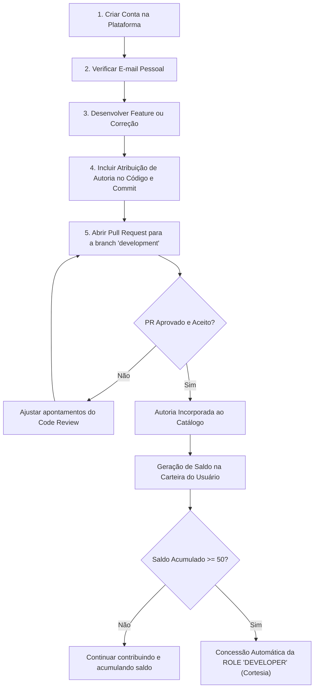

# Portal Apps - Diretrizes para Colaboradores e Desenvolvedores

Bem-vindo ao ecossistema de desenvolvimento e colaboração do **Portal Apps** (`ci.dev.br`).

Este documento estabelece o fluxo oficial de contribuição, a política de geração de saldo na plataforma e as regras para a concessão da **ROLE DEVELOPER** como cortesia vitalícia aos colaboradores.

---

## 1. Visão Geral do Programa de Colaboradores

A plataforma valoriza e recompensa o trabalho intelectual e a dedicação técnica da comunidade de desenvolvedores. Toda contribuição aceita que agregue valor, resolva falhas ou introduza novas funcionalidades passa a compor o patrimônio tecnológico da plataforma, com atribuição permanente ao seu criador.

### Pilares Fundamentais:
1. **Transparência de Autoria:** Todo código, especificação ou recurso deve conter a assinatura do autor com seu e-mail pessoal permanente, conforme o [Guia de Boas Práticas e Autoria](./guia-boas-praticas-referencias.md).
2. **Geração de Saldo por Contribuição:** Pull Requests (PRs) aceitos na branch `development` geram saldo diretamente na carteira digital do autor na plataforma.
3. **Reconhecimento Meritocrático:** Desenvolvedores com autoria comprovada e e-mail verificado recebem a **ROLE DEVELOPER** como cortesia da plataforma ao atingirem 50 de saldo.

---

## 2. Fluxo de Contribuição via Pull Request (PR)

Para contribuir com o projeto, siga o fluxo padronizado abaixo:

### 2.1. Branch Alvo Obrigatória
* Todos os Pull Requests devem ter como branch de destino a branch **`development`**.
* Pull Requests abertos diretamente contra branches protegidas ou de produção (`master`/`main`) não serão aceitos diretamente.

### 2.2. Requisitos de Autoria no PR
Ao submeter o PR, garanta que:
1. O seu **e-mail pessoal** permanente esteja configurado no Git (`git config user.email "seu.email@dominio.com"`).
2. O mesmo e-mail esteja associado e devidamente verificado na sua conta na plataforma (`apps.ci.dev.br`).
3. O cabeçalho dos arquivos criados ou modificados contenha a citação de autoria formal (veja o [Guia de Boas Práticas e Autoria](./guia-boas-praticas-referencias.md)).
4. Caso atue em conjunto com outros colaboradores, utilize tags `Co-authored-by:` no corpo do commit.

---

## 3. Geração de Saldo na Plataforma

Quando um Pull Request é aceito e mergeado na branch `development`:
1. A rotina de catalogação (`generate-git-version.js` e `ApplicationService.reconcileCatalog`) extrai os dados de autoria e registra os colaboradores associados a cada aplicação e versão.
2. O sistema reconhece a contribuição e vincula a geração de saldo à carteira digital do usuário correspondente ao e-mail do autor.
3. O saldo acumulado fica visível na carteira digital do usuário (`/Financeiro/Carteira`) e pode ser utilizado na liquidação de serviços ou acumulado para progressão de perfil.

---

## 4. Regra de Concessão da ROLE DEVELOPER (Cortesia)

A plataforma concede a **ROLE DEVELOPER** gratuitamente como cortesia vitalícia aos colaboradores que atenderem aos seguintes requisitos cumulativos:

| Critério | Requisito Técnico | Descrição |
| :--- | :--- | :--- |
| **1. E-mail Verificado** | `emailVerificado === true` | O usuário deve ter confirmado seu endereço de e-mail na plataforma através do fluxo de validação. |
| **2. Autoria Comprovada** | Registro no Git / Catálogo | O e-mail verificado deve constar como autor ou coautor de contribuições em PR aceito para a branch `development`. |
| **3. Saldo Mínimo** | `carteira.saldo >= 50.00` | O usuário deve alcançar um saldo de pelo menos 50 (cinquenta) na plataforma, gerado pelas suas contribuições. |

> [!NOTE]
> **Ativação Automática:** Assim que o saldo atinge 50 (seja por crédito de contribuição, depósito ou ao consultar a carteira), o serviço backend `CarteiraService` valida a autoria associada ao e-mail e aplica imediatamente a role `DEVELOPER` no perfil do usuário, sem necessidade de aprovação burocrática manual.

---

## 5. Privilégios e Vantagens da ROLE DEVELOPER

Ao receber a `ROLE DEVELOPER`, o usuário ganha acesso exclusivo a recursos operacionais avançados do portal:

* **Menu Deployer (`#deployMenu`):** Acesso à central de deploy e build da aplicação (`/gulp`), permitindo acionar tarefas de compilação e publicação diretamente pela interface.
* **Alternância de Ambientes:** Botão para alternar dinamicamente entre os domínios de produção (`apps.ci.dev.br`) e de desenvolvimento (`development.ci.dev.br`).
* **Catalogação de Aplicações Git:** Permissão para registrar novos módulos e aplicações a partir de repositórios Git no catálogo do portal.
* **Acesso ao Codex e Ferramentas Técnicas:** Permissão para utilizar as IDEs internas, ferramentas de depuração de nós e inspeção de logs de execução.
* **Endpoints Protegidos por `@Role('DEVELOPER')`:** Liberação de chamadas para rotas restritas de build, changelog técnico e governança de serviços.

---

## 6. Colaboradores Ativos

Lista de colaboradores e autores com notoriedade reconhecida no projeto:

* **Paulo Henrique Xavier (plhx):** [plhx@plhx.com.br](mailto:plhx@plhx.com.br) | [eu@plhx.com.br](mailto:eu@plhx.com.br)
* **Paulo Rettamozo (pLinho):** [paulorettamozo@gmail.com](mailto:paulorettamozo@gmail.com)

---

*Para dúvidas ou para acompanhar o status de seus PRs e saldo, acesse o menu de Carteira em [apps.ci.dev.br/Financeiro/Carteira](https://apps.ci.dev.br) ou entre em contato com a equipe de engenharia.*
