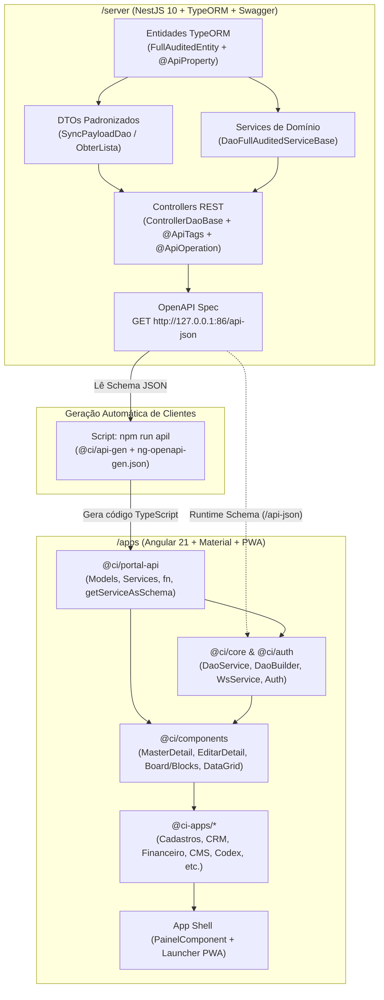

# Especificação Técnica e Guia de Manutenção — Plataforma **Apps**

> **Apps** — *Application Manager Boilerplate, Build And Blocks PWAs*  
> Plataforma universal modular para construção, gerenciamento e entrega de aplicações web progressivas (PWAs), sistemas corporativos multi-tenant e blocos dinâmicos de interface com **Angular** (`/apps`) e **NestJS** (`/server`).

---

## Sumário

1. [Visão Geral da Arquitetura](#1-visão-geral-da-arquitetura)
2. [Estrutura de Diretórios do Monorepo](#2-estrutura-de-diretórios-do-monorepo)
3. [Arquitetura do Backend (`/server` — NestJS)](#3-arquitetura-do-backend-server--nestjs)
   - [3.1. Sistema de Módulos Dinâmicos (`libs/` e `.env`)](#31-sistema-de-módulos-dinâmicos-libs-e-env)
   - [3.2. Hierarquia de Entidades, Auditoria e Snapshots](#32-hierarquia-de-entidades-auditoria-e-snapshots)
   - [3.3. Convenções de Decorators Swagger/OpenAPI para UI Dinâmica](#33-convenções-de-decorators-swaggeropenapi-para-ui-dinâmica)
   - [3.4. Padrão de DTOs (`SyncPayloadDao`, `ObterLista`, `GetByInternalIdInputDto`)](#34-padrão-de-dtos-syncpayloaddao-obterlista-getbyinternalidinputdto)
   - [3.5. Padrão de Services (`DaoFullAuditedServiceBase`)](#35-padrão-de-services-daofullauditedservicebase)
   - [3.6. Padrão de Controllers (`ControllerDaoBase`)](#36-padrão-de-controllers-controllerdaobase)
   - [3.7. Orquestração de Processos, Warmup e Porta 86 (`main.ts`)](#37-orquestração-de-processos-warmup-e-porta-86-maints)
4. [Pipeline de Geração de Código da API (`npm run apil`)](#4-pipeline-de-geração-de-código-da-api-npm-run-apil)
   - [4.1. Como funciona o `@ci/api-gen`](#41-como-funciona-o-ciapi-gen)
   - [4.2. Regras Obrigatórias no Backend para o `npm run apil`](#42-regras-obrigatórias-no-backend-para-o-npm-run-apil)
   - [4.3. Como executar e validar a geração](#43-como-executar-e-validar-a-geração)
5. [Arquitetura do Cliente (`/apps` — Angular & PWA)](#5-arquitetura-do-cliente-apps--angular--pwa)
   - [5.1. Camada de Fundações (`projects/ci/*`)](#51-camada-de-fundações-projectsci)
   - [5.2. Camada de Aplicativos Modulares (`projects/ci-apps/*`)](#52-camada-de-aplicativos-modulares-projectsci-apps)
   - [5.3. Sistema de "Blocks" (Cards e Dashboards Modulares)](#53-sistema-de-blocks-cards-e-dashboards-modulares)
   - [5.4. Motor de Schemas em Runtime (`DaoService`, `DaoBuilder` e `MasterDetailComponent`)](#54-motor-de-schemas-em-runtime-daoservice-daobuilder-e-masterdetailcomponent)
   - [5.5. Recursos PWA, SSR e Servir Estáticos no Backend](#55-recursos-pwa-ssr-e-servir-estáticos-no-backend)
6. [Roteiros Práticos de Manutenção (Playbooks)](#6-roteiros-práticos-de-manutenção-playbooks)
   - [6.1. Criar ou Manter uma Entidade, DTO, Service e Controller + `npm run apil`](#61-criar-ou-manter-uma-entidade-dto-service-e-controller--npm-run-apil)
   - [6.2. Criar um Novo Módulo de Domínio no Backend (`/server/libs`)](#62-criar-um-novo-módulo-de-domínio-no-backend-serverlibs)
   - [6.3. Criar um Novo Aplicativo Modular no Cliente (`@ci-apps/*`)](#63-criar-um-novo-aplicativo-modular-no-cliente-ci-apps)
   - [6.4. Criar um Novo Bloco Visual (`ImplCard`)](#64-criar-um-novo-bloco-visual-implcard)
7. [Comandos de Build, Desenvolvimento e Deploy](#7-comandos-de-build-desenvolvimento-e-deploy)
8. [Boas Práticas e Troubleshooting](#8-boas-práticas-e-troubleshooting)

---

## 1. Visão Geral da Arquitetura

O projeto **Apps** é estruturado como um **Application Manager Boilerplate Build And Blocks PWAs**. Seu objetivo é fornecer uma base unificada onde múltiplos aplicativos de negócios (`@ci-apps/*`) e blocos visuais reutilizáveis (*Cards/Blocks*) coexistem dentro de um único ecossistema PWA, apoiados por metadados gerados diretamente do backend.



### Pilares Arquiteturais
1. **Single Source of Truth (Fonte Única da Verdade)**: As entidades do banco de dados e seus DTOs no `/server` definem simultaneamente o esquema relacional (TypeORM), o contrato da API REST (Swagger/OpenAPI), os clientes HTTP tipados do Angular (`@ci/portal-api` via `npm run apil`) e a geração dinâmica de formulários e tabelas no frontend (`DaoBuilder` e `GridBuilder`).
2. **Arquitetura Orientada a Blocos e Mini-Apps**: O cliente Angular (`/apps`) funciona como um *Application Manager* (gerenciador de aplicações) que carrega sob demanda módulos independentes (`@ci-apps/*`) e blocos de dashboard (`ImplCard` no `BoardModule`).
3. **Sincronização Auditável e Tempo Real**: As operações de escrita seguem o padrão `Sync` (criação/atualização unificada com detecção de deltas, auditoria de usuário/tenant e criação de `Snapshot` histórico) aliado à propagação via WebSockets (`WsService`).

---

## 2. Estrutura de Diretórios do Monorepo

```text
c:\projetos\br.dev.ci.apps\
├── apps/                                  # Aplicação Cliente (Angular 21 Workspace)
│   ├── ng-openapi-gen.json                # Configuração de entrada/saída do gerador OpenAPI
│   ├── ngsw-config.json                   # Configuração do Service Worker (PWA)
│   ├── angular.json                       # Definição da aplicação principal e subprojetos (@ci/* e @ci-apps/*)
│   ├── package.json                       # Scripts do cliente (incluindo "apil") e dependências Angular
│   ├── tsconfig.json                      # Path mappings (@ci/* e @ci-apps/*)
│   ├── public/                            # Assets públicos e manifest.webmanifest
│   ├── src/                               # App Shell principal (Painel, Homepage, Acessar, Registrar)
│   │   └── app/
│   │       ├── app.config.ts              # Configuração global de providers, Gateways, API, Auth e Cards
│   │       ├── app.routes.ts              # Rotas de topo (Homepage, Acessar, Registrar, Painel)
│   │       ├── cards.ts                   # Registro global de Blocks/Cards (ImplCard[])
│   │       └── painel/                    # Container autenticado e catálogo de aplicativos (CI_STATIC_APPS)
│   └── projects/                          # Bibliotecas internas do workspace Angular
│       ├── ci/                            # Bibliotecas de Fundação (@ci/portal-api, @ci/core, @ci/components, @ci/auth, @ci/Launcher, etc.)
│       └── ci-apps/                       # Aplicativos Modulares de Negócio (@ci-apps/Cadastros, @ci-apps/crm, @ci-apps/Financeiro, etc.)
│
├── server/                                # Aplicação Backend (NestJS 10 Monorepo)
│   ├── nest-cli.json                      # Registro das bibliotecas NestJS em libs/*
│   ├── package.json                       # Scripts e dependências do servidor
│   ├── tsconfig.json                      # Path mappings (@ci/* -> libs/*/src)
│   ├── STATUS                             # Arquivo gerenciado em runtime pela orquestração de processos (porta 86)
│   ├── public/                            # Destino do build de produção do Angular servido estaticamente
│   ├── src/
│   │   ├── main.ts                        # Bootstrap, Swagger (/api e /api-json) e Orquestrador da Porta 86
│   │   ├── app.module.ts                  # Carregamento dinâmico de módulos e entidades via process.env.MODULES
│   │   └── app.controller.ts              # Entrega de páginas CMS, manifest dinâmico e arquivos estáticos com cache FIFO
│   └── libs/                              # Módulos de Domínio e Infraestrutura do Backend (@ci/*)
│       ├── core/                          # Logging, Auditoria, Infra, System, i18n, WebSockets
│       ├── manager/                       # Classes Base DAO (FullAuditedEntity, ControllerDaoBase, DaoFullAuditedServiceBase, SnapshotService)
│       ├── auth/                          # Autenticação JWT, Credenciais, Roles e Guards
│       ├── tenant/                        # Multi-tenancy
│       ├── cadastro/                      # Exemplo de módulo de domínio (Pessoa, Endereco, Pais, UnidadeMedida, etc.)
│       └── ...                            # Demais módulos (crm, cms, financeiro, fiscal, forms, projetos, vendas, etc.)
│
├── docs/                                  # Documentação técnica do projeto
├── deploy.js                              # Script de build de produção do cliente e cópia para server/public
└── package.json                           # Scripts utilitários da raiz (deploy, sync, commiter)
```

---

## 3. Arquitetura do Backend (`/server` — NestJS)

### 3.1. Sistema de Módulos Dinâmicos (`libs/` e `.env`)
O backend utiliza a estrutura de bibliotecas do NestJS (`server/libs/<nome-da-lib>`).
- Todas as bibliotecas são mapeadas no `server/nest-cli.json` e no `server/tsconfig.json` sob o namespace `@ci/<modulo>` (ex.: `@ci/cadastro`, `@ci/financeiro`, `@ci/crm`).
- Em `server/src/app.module.ts`, os objetos `_entities_name` e `_modules_name` registram os arrays de entidades (`*Entities`) e os módulos (`*Module`) disponíveis.
- A variável de ambiente `MODULES` (definida em `.env` para produção ou `.env.dev` para desenvolvimento) contém a lista separada por vírgulas dos módulos que devem ser ativados na inicialização:
  ```typescript
  process.env.MODULES.split(',').forEach(e => {
    if (_entities_name[e]) LoadedEntities.push(..._entities_name[e]);
    if (_modules_name[e]) LoadedModules.push(_modules_name[e]);
  });
  ```

### 3.2. Hierarquia de Entidades, Auditoria e Snapshots
As entidades persistidas via TypeORM (com `SnakeNamingStrategy`) devem herdar das classes base localizadas em `server/libs/manager/src/dao/entities.ts` (reexportadas por `@ci/core` e `@ci/manager`):

1. **`BasicIdentifiedEntity`**:
   - Define a chave primária padrão `internalId?: string` (`@PrimaryGeneratedColumn('uuid')`).
2. **`AuditedEntity` (estende `BasicIdentifiedEntity`)**:
   - Adiciona suporte nativo a Multi-Tenancy (`tenants?: Tenant[]`), rastreamento de criação (`createdAt`, `createdBy`), modificação (`lastModifiedAt`, `lastModifiedBy`) e exclusão lógica (`deleted?: boolean`).
3. **`FullAuditedEntity` (estende `AuditedEntity`)**:
   - Classe base recomendada para todas as entidades de negócio.
   - Mantém vínculo `@ManyToMany(() => Snapshot)` no schema `snapshot`, permitindo que o `SnapshotService` grave automaticamente o histórico de estados da entidade a cada sincronização.

### 3.3. Convenções de Decorators Swagger/OpenAPI para UI Dinâmica
No **Apps**, os decorators `@ApiProperty` do `@nestjs/swagger` **não servem apenas para documentação**: o cliente Angular lê `/api-json` em tempo de execução (`DaoBuilder` e `GridBuilder`) para construir automaticamente colunas de tabelas e campos de formulários dinâmicos.

Ao declarar colunas em uma entidade:
- Sempre informe `title` (usado como label do campo/coluna no frontend), `description`, `nullable` e `required`.
- Para relacionamentos (`@ManyToMany`, `@OneToMany`, `@ManyToOne`), especifique explicitamente `type: ClasseRelacionada` (ou `() => ClasseRelacionada`) e `isArray: true` quando aplicável.
- Defina o `schema` do banco de dados no decorator `@Entity({ schema })` do módulo correspondente.

**Exemplo padrão (`server/libs/cadastro/src/model/pessoa.entity.ts`):**
```typescript
@Entity({ schema })
export class Pessoa extends FullAuditedEntity {
    @ApiProperty({
        required: false,
        nullable: true,
        title: 'Nome',
        description: 'Nome'
    })
    @Column({ nullable: true, length: 120 })
    nome?: string;
}
```

### 3.4. Padrão de DTOs (`SyncPayloadDao`, `ObterLista`, `GetByInternalIdInputDto`)
Para que o gerador `npm run apil` produza tipos consistentes no `@ci/portal-api`, cada entidade exposta em um controller DAO deve possuir seus DTOs tipados para o Swagger:

1. **DTO de Sincronização (`SyncPayloadDao<Entidade>`)**:
   Estende `SyncPayloadDao<T>` (de `@ci/manager`) sobrescrevendo a propriedade `data` com `@ApiProperty({ type: Entidade })`:
   ```typescript
   import { SyncPayloadDao } from "@ci/manager";
   import { ApiProperty } from "@nestjs/swagger";
   import { Pessoa } from "../model/pessoa.entity";

   export class SyncPayloadDaoPessoa extends SyncPayloadDao<Pessoa> {
       @ApiProperty({ type: Pessoa })
       override data?: Pessoa;
   }
   ```
2. **DTO de Listagem (`ObterLista<Entidade>`)**:
   Define os parâmetros de paginação e filtro (`skip`, `take`, `where`):
   ```typescript
   import { ApiProperty } from "@nestjs/swagger";
   import { FindOptionsWhere } from "typeorm";
   import { Pessoa } from "../model/pessoa.entity";

   export class ObterListaPessoa {
       @ApiProperty({})
       skip?: number;
       @ApiProperty({})
       take?: number;
       @ApiProperty({})
       where?: FindOptionsWhere<Pessoa>[] | FindOptionsWhere<Pessoa>;
   }
   ```
3. **DTO de Busca por ID Interno (`GetByInternalIdInputDto`)**:
   Recebe `{ internalId: string }`.

### 3.5. Padrão de Services (`DaoFullAuditedServiceBase`)
Os serviços de entidades auditáveis herdam de `DaoFullAuditedServiceBase<Entidade>` (de `@ci/core` / `@ci/manager`), injetando `SnapshotService` e o `Repository<Entidade>` do TypeORM:

```typescript
import { Repository } from "typeorm";
import { Pessoa } from "../model/pessoa.entity";
import { InjectRepository } from "@nestjs/typeorm";
import { DaoFullAuditedServiceBase, SnapshotService } from "@ci/core";

export class PessoaService extends DaoFullAuditedServiceBase<Pessoa> {
    constructor(
        snap: SnapshotService,
        @InjectRepository(Pessoa)
        repository: Repository<Pessoa>
    ) {
        super(snap, repository);
    }
}
```
Comportamentos herdados automaticamente:
- `sincronizar(data, request)`: Cria o registro se não possuir `internalId` (vinculando `createdBy` à `chaveAcesso` da requisição) ou atualiza apenas os campos alterados caso `internalId` exista (ignorando `undefined`, permitindo `null` para limpar campos, atualizando `lastModifiedAt`/`lastModifiedBy` e gravando `Snapshot`).
- `obterLista(options, request)`: Filtra registros não deletados (`deleted: IsNull()`) respeitando a visibilidade do usuário autenticado e papel `ADMIN`.
- `getByInternalId(internalId, request)`: Retorna a entidade populada com metadados `__name`.
- `delete(data, request)`: Realiza *soft-delete* marcando `deleted = true`.

### 3.6. Padrão de Controllers (`ControllerDaoBase`)
Os controllers de entidade herdam de `ControllerDaoBase<Service, Entidade>` e expõem rotas `POST` padronizadas (`Sync`, `GetByInternalId`, `GetList`, `Delete`):

```typescript
@ApiTags('Pessoa')
@Controller('Pessoa')
export class PessoaController extends ControllerDaoBase<PessoaService, Pessoa> {
    constructor(service: PessoaService) {
        super(service);
    }

    @Post('Sync')
    @ApiResponse({ type: SyncPayloadDaoPessoa })
    @ApiOperation({ operationId: 'SyncPessoa' })
    override async Sync(@Body() body: SyncPayloadDaoPessoa, @Req() req?: any) {
        return await super.Sync(body, req);
    }

    @Post('GetByInternalId')
    @ApiResponse({ type: Pessoa })
    @ApiOperation({ operationId: 'GetByInternalIdPessoa' })
    override async GetByInternalId(@Body() input: GetByInternalIdInputDto, @Req() req?: any) {
        return await super.GetByInternalId(input, req);
    }

    @Post('GetList')
    @ApiResponse({ type: SyncPayloadDaoPessoa })
    @ApiOperation({ operationId: 'GetListPessoa' })
    override async GetList(@Body() input: ObterListaPessoa, @Req() req?: any) {
        return super.GetList(input, req);
    }

    @Post('Delete')
    @ApiResponse({ type: Pessoa })
    @ApiOperation({ operationId: 'DeletePessoa' })
    override async Delete(@Body() body: Pessoa, @Req() req?: any) {
        return await super.Delete(body, req);
    }
}
```
> [!IMPORTANT]
> Se a entidade deve aparecer automaticamente nos menus de edição dinâmica do módulo (como em `CadastrosComponent`), adicione-a ao provider `'CLIENT.MODEL.EDITABLES'` no módulo NestJS correspondente (ex.: `useValue: [...(CadastroEntidades.map(e => e.name))]`).

### 3.7. Orquestração de Processos, Warmup e Porta 86 (`main.ts`)
O arquivo `server/src/main.ts` implementa um orquestrador próprio de alta disponibilidade e suporte a depuração:
1. **Warmup em Porta Secundária**: Nenhuma instância sobe diretamente na porta `86`. O servidor sorteia uma porta secundária livre (`1024..65535`), inicializa o NestJS e valida sua própria prontidão HTTP através do endpoint interno `GET /__orchestration/health`.
2. **Coordenação via Arquivo `server/STATUS`**: Todas as instâncias ativas registram seu PID, porta, heartbeat, flag `debug` e estado (`running`, `online`, `stopped`, `fail`) no arquivo `server/STATUS`, verificando-o em ciclos de `300ms` e via *file watcher*.
3. **Assunção e Rotação da Porta `86`**:
   - A porta `86` é o ponto focal de entrada da API local (inclusive consumida pelo `npm run apil` em `http://127.0.0.1:86/api-json`).
   - Instâncias em modo **DEBUG** (`--debug` / `--inspect` / VSCode Debugger) têm **prioridade máxima**: assim que aquecem, assumem a porta `86` imediatamente (e, se derrubarem um processo normal ocupante, disparam uma instância de reposição em background via `node dist/main.js`).
   - Entre instâncias normais (não-debug), ocorre handoff seguro com teste HTTP prévio a cada `10 segundos` (`PORT_86_ROTATION_MS`), mantendo zero-downtime.

---

## 4. Pipeline de Geração de Código da API (`npm run apil`)

O comando `npm run apil` (executado na pasta `/apps`) é o elo central entre o backend NestJS (`/server`) e o frontend Angular (`/apps`).

### 4.1. Como funciona o `@ci/api-gen`
No arquivo `apps/package.json`:
```json
"scripts": {
  "api": "node node_modules/ng-openapi-gen/lib/index.js",
  "apil": "node node_modules/@ci/api-gen/lib/index.js"
}
```
O script `npm run apil` executa o pacote customizado `@ci/api-gen`, que lê a configuração de `apps/ng-openapi-gen.json`:
```json
{
    "$schema": "node_modules/ng-openapi-gen/ng-openapi-gen-schema.json",
    "input": "http://127.0.0.1:86/api-json",
    "output": "projects/ci/portal-api/src/lib",
    "ignoreUnusedModels": false
}
```

**Por que usar sempre `npm run apil` (e nunca `npm run api` isoladamente)?**  
O gerador `@ci/api-gen` possui duas customizações essenciais para a arquitetura do **Apps**:
1. **Remoção do sufixo da Tag no nome dos métodos dos Services (`service.js`)**:
   - No `@ci/api-gen`, a linha `variant.methodName = variant.methodName.replace(tag.name, '');` remove o nome da Tag do método gerado no Service Angular.
   - Exemplo: Em um controller com `@ApiTags('Pessoa')` e `@ApiOperation({ operationId: 'SyncPessoa' })`, a função auxiliar gerada em `fn/pessoa/sync-pessoa.ts` chama-se `syncPessoa`, mas o método exposto na classe `PessoaService` chama-se **`sync()`** (e analogamente **`getList()`**, **`getByInternalId()`**, **`delete()`**).
   - Isso garante que todos os Services gerados em `@ci/portal-api` obedeçam às interfaces polimórficas `IHaveSync<E>`, `IHaveGetList<E>` e `IHaveDelete<E>` exigidas pelo `MasterDetailComponent` e pelo `DaoService`.
2. **Geração do Resolvedor Dinâmico `getServiceAsSchema(schema: string)` (`module.handlebars`)**:
   - O template customizado de `api.module.ts` gera e exporta a função:
     ```typescript
     export function getServiceAsSchema(schema: string): Type<any> {
       return ({ 'PessoaService': PessoaService, ... }[schema + 'Service'] as any) || undefined;
     }
     ```
   - Graças a essa função, qualquer componente dinâmico que receba apenas `schemaName = 'Pessoa'` consegue injetar `PessoaService` dinamicamente via `this.injector.get(getServiceAsSchema(this.schemaName))`.

### 4.2. Regras Obrigatórias no Backend para o `npm run apil`
Para que o `npm run apil` gere um serviço compatível com a infraestrutura dinâmica do cliente:

| Elemento no Controller NestJS | Regra Obrigatória | Exemplo (`PessoaController`) | Resultado em `@ci/portal-api` |
| :--- | :--- | :--- | :--- |
| **`@ApiTags(...)`** | Deve ter exatamente o nome da Entidade (`PascalCase`). | `@ApiTags('Pessoa')` | Gera `PessoaService` e registra `'PessoaService'` em `getServiceAsSchema('Pessoa')`. |
| **`@Controller(...)`** | Mesmo nome da Entidade. | `@Controller('Pessoa')` | Define o prefixo de rota `/Pessoa/*`. |
| **`@ApiOperation({ operationId })`** | Deve seguir o formato **`<VerboPascalCase><NomeDaTag>`** (`Sync<Tag>`, `GetList<Tag>`, `GetByInternalId<Tag>`, `Delete<Tag>`). | `@ApiOperation({ operationId: 'SyncPessoa' })` | Gera função `syncPessoa` em `fn/` e método `.sync()` em `PessoaService`. |
| **`@ApiResponse({ type })`** | Sempre declarar o DTO/Entidade de retorno. | `@ApiResponse({ type: SyncPayloadDaoPessoa })` | Tipa o `Observable<SyncPayloadDaoPessoa>` no cliente. |
| **`@Body()`** | Sempre tipar o parâmetro com uma classe decorada com `@ApiProperty`. | `@Body() body: SyncPayloadDaoPessoa` | Gera a interface `SyncPessoa$Params` com `{ body: SyncPayloadDaoPessoa }`. |

> [!WARNING]
> **Nunca omita o `operationId` nem deixe `operationId` duplicados** entre diferentes controllers! Caso `operationId` não termine com o nome exato de `@ApiTags`, o método no Service Angular não será simplificado para `.sync()`, `.getList()`, `.getByInternalId()` ou `.delete()`, quebrando a integração automática com `MasterDetailComponent`.

### 4.3. Como executar e validar a geração
1. Certifique-se de que o módulo desejado está listado na variável `MODULES` do arquivo `.env.dev` / `.env` em `/server`.
2. Inicie o backend (`/server`) e aguarde o log confirmando que a instância assumiu a porta `86`:
   ```
   [Orquestração] Aplicação (PID XXXX) assumiu a porta 86 com sucesso!
   ```
3. Verifique se `http://127.0.0.1:86/api-json` está acessível.
4. No terminal, dentro da pasta `/apps`, execute:
   ```powershell
   npm run apil
   ```
5. Confirme a mensagem final:
   ```text
   Generation from http://127.0.0.1:86/api-json finished with X models and Y services.
   ```
6. **Nunca edite manualmente** os arquivos dentro de `apps/projects/ci/portal-api/src/lib/`, pois o diretório é sincronizado e arquivos obsoletos são removidos automaticamente a cada execução de `npm run apil`.

---

## 5. Arquitetura do Cliente (`/apps` — Angular & PWA)

A aplicação cliente utiliza **Angular 21**, compondo uma arquitetura de *Micro-Frontends Modulares* via bibliotecas internas do workspace (`apps/projects/`).

### 5.1. Camada de Fundações (`projects/ci/*`)
Mapeadas sob o escopo `@ci/*` no `apps/tsconfig.json`:
- **`@ci/portal-api`**: Camada de comunicação REST gerada automaticamente pelo `npm run apil`. Exporta `ApiModule`, `ApiConfiguration`, `BaseService`, todos os `models`, `services` e `getServiceAsSchema`.
- **`@ci/core`**: Núcleo arquitetural do cliente:
  - `coreProvider(options)`: Configura os gateways de API (`rootApi`, `alternativeApiGateways`, `gateway` WebSocket), locale `pt-BR` e `servicesCommons` (`ISchemaPreset`).
  - `DaoService` & `DaoBuilder`: Carregam `/api-json` em memória, constroem `FormGroup` a partir do JSON Schema da entidade, monitoram alterações em objetos (`getChanges`, `prepareToEdit`, `read`), gerenciam confirmações e propagam mudanças via `WsService`.
  - `AuthorizationHttpInterceptor` & `authGuard`: Injetam tokens de autorização nas requisições HTTP e protegem rotas autenticadas.
  - `IconLoaderSerices` & `LoadIconsModule`: Carregamento sob demanda de ícones SVG customizados.
- **`@ci/auth`**: Gerenciamento de sessão do usuário (`UserAuthenticationService`), telas/componentes de perfil (`ProfileMenu`) e token de injeção `USER_MENU`.
- **`@ci/components`** (e sub-entrypoints `@ci/components/*`):
  - `@ci/components/master-detail`: `MasterDetailComponent` — componente universal de listagem e CRUD baseado em `schemaName`.
  - `@ci/components/editar-detail`: Modal/view de edição automática de entidades.
  - `@ci/components/data-grid`: `GridBuilder` e componentes de tabela orientados a schema.
  - `@ci/components/dyn-form`: Renderização dinâmica de formulários.
  - `@ci/components/window`: Gerenciador de janelas modais/flutuantes e menus (`WindowService`, `IItemMenu`).
  - `@ci/components` (`BoardModule` / `@ci/components/cardboard`): Motor de dashboards baseados em *Blocks/Cards* (`BoardComponent`, `CardSetting`, `ImplCard`) com suporte a drag-and-drop.
- **`@ci/Launcher`**: Tela inicial do painel que exibe os aplicativos disponíveis para o usuário.

### 5.2. Camada de Aplicativos Modulares (`projects/ci-apps/*`)
Cada funcionalidade de negócio é isolada como uma biblioteca em `apps/projects/ci-apps/<nome>` e mapeada sob `@ci-apps/<Nome>` (ex.: `@ci-apps/Arquivos`, `@ci-apps/Cadastros`, `@ci-apps/Codex`, `@ci-apps/crm`, `@ci-apps/cms`, `@ci-apps/Financeiro`, `@ci-apps/Formularios`, `@ci-apps/Gerencial`, `@ci-apps/Infra`, `@ci-apps/LowCode`, `@ci-apps/Mensagens`, `@ci-apps/Organizacao`, `@ci-apps/Produtos`, `@ci-apps/Projetos`, `@ci-apps/SEO`, `@ci-apps/Threejs`, `@ci-apps/Treinamento`, `@ci-apps/Vendas`).

**Convenção de estrutura de um pacote `@ci-apps/*`:**
1. **`src/public-api.ts`**: Deve exportar obrigatoriamente `CiApplicationModule` (e opcionalmente `export * as Cards from './lib/cards'` quando fornecer blocos de dashboard).
2. **`CiApplicationModule` e `CiApplicationRoutingModule`**: Configuram as rotas internas do mini-app (que são carregadas via `loadChildren` em `apps/src/app/painel/painel-routing.module.ts`).
3. **Catálogo e Controle de Acesso (`CI_STATIC_APPS`)**:
   Em `apps/src/app/painel/apps/apps.ts`, a constante `CI_STATIC_APPS: IApp[]` define metadados do aplicativo (`name`, `url`, `icon`, `type: 'svg' | 'mat'`, `shortDescription`, `description`, `categoria` e `roles: ['USER', 'ADMIN', 'MASTER']`). O `PainelComponent` filtra os aplicativos visíveis de acordo com as `roles` do usuário autenticado e ordena os favoritos pelo uso no `localStorage` (`x-menu-cached-favs`).

### 5.3. Sistema de "Blocks" (Cards e Dashboards Modulares)
O conceito de **Blocks** no **Apps** permite que qualquer biblioteca `@ci-apps/*` ou `@ci/components/*` exponha widgets independentes (Cards) que o usuário pode adicionar, configurar e organizar em quadros (`BoardComponent`).

**Estrutura de um Block (`ImplCard`):**
1. Cria-se um componente Angular (preferencialmente `standalone: true`).
2. No mesmo arquivo, exporta-se uma constante cujo nome **deve conter o sufixo `CardInfo`** (ex.: `TotalCardInfo`, `CalendarCardInfo`) implementando a interface `ImplCard`:
   ```typescript
   export const TotalCardInfo: ImplCard = {
       title: 'Totalizador',
       descricao: 'Visualize a totalização de um conjunto de dados.',
       tags: ['Total'],
       componentRef: TotalComponent,
       componentVersion: '1.0.0',
       componentName: 'TotalComponent',
       settings: {}
   };
   ```
3. O arquivo `cards/index.ts` da biblioteca reexporta todos os componentes/CardInfos, e o `public-api.ts` exporta `export * as Cards from './lib/cards'`.
4. Em `apps/src/app/cards.ts`, o módulo de cards é adicionado ao array `CardModule`, que varre automaticamente todas as exportações contendo `'CardInfo'` no nome e as injeta globalmente via token `CardSetting`.

### 5.4. Motor de Schemas em Runtime (`DaoService`, `DaoBuilder` e `MasterDetailComponent`)
A manutenção de telas CRUD em `@ci-apps/*` é fortemente acelerada pelo uso do `MasterDetailComponent`:
- Na rota do módulo (ex.: `apps/projects/ci-apps/cadastros/src/lib/ci-application/ci-application-routing.module.ts`), basta apontar para `MasterDetailComponent` passando `:EntityName` na URL ou `data: { schema: 'NomeDaEntidade' }` (ou usando o helper `RouteFromSchema('NomeDaEntidade', MasterDetailComponent)` de `@ci/core`).
- Fluxo automático do `MasterDetailComponent`:
  1. Obtém `schemaName` da rota ou `@Input()`.
  2. Consulta `DaoBuilder.getSchema(schemaName)` e `GridBuilder.FromSchema(schemaName)` (baseados em `/api-json`).
  3. Resolve o Service correspondente via `getServiceAsSchema(schemaName)` (gerado pelo `npm run apil`).
  4. Executa `service.getList({ body: ... })`, encapsula os objetos no `DaoService.read()` para rastreamento de estado e exibe os registros.
  5. Ao criar ou editar um item, abre o `EditarDetailComponent`, que sincroniza as alterações com `service.sync({ body: { data } })` e propaga via `WsService`.

### 5.5. Recursos PWA, SSR e Servir Estáticos no Backend
- **Service Worker**: Configurado em `apps/ngsw-config.json` e registrado em `apps/src/app/app.config.ts` (`provideServiceWorker('ngsw-worker.js', { enabled: true, registrationStrategy: 'registerWhenStable:30000' })`).
- **Web App Manifest**: `apps/public/manifest.webmanifest` no cliente e geração dinâmica multi-domínio em `server/src/app.controller.ts` (`getManifestApplication`).
- **Entrega Híbrida pelo Backend (`AppController`)**:
  Quando uma requisição `GET` chega ao `/server`:
  1. Se for `manifest.webmanifest`, retorna o manifesto customizado para o host atual.
  2. Se o módulo CMS (`SitePageService`) estiver ativo e houver página cadastrada para aquele `host` e `path`, renderiza o conteúdo dinâmico do CMS.
  3. Caso contrário, serve os arquivos compilados do Angular localizados em `server/public` utilizando cache em memória FIFO (até 40 arquivos de até 300KB) e cabeçalhos `Cache-Control` otimizados para Cloudflare, fazendo fallback de rotas SPA para `index.csr.html`.

---

## 6. Roteiros Práticos de Manutenção (Playbooks)

### 6.1. Criar ou Manter uma Entidade, DTO, Service e Controller + `npm run apil`

Sempre que precisar criar uma nova entidade ou adicionar campos/endpoints a uma entidade existente, siga esta sequência exata:

1. **Entidade (`server/libs/<modulo>/src/model/<entidade>.entity.ts`)**:
   - Estenda `FullAuditedEntity` (de `@ci/core`).
   - Adicione `@Entity({ schema })`.
   - Decore **todas** as propriedades com `@Column(...)` e `@ApiProperty({ title: '...', required: ..., nullable: ... })`.
2. **DTOs (`server/libs/<modulo>/src/dto/`)**:
   - Crie `SyncPayloadDao<Entidade>` estendendo `SyncPayloadDao<Entidade>` com `@ApiProperty({ type: Entidade }) override data?: Entidade;`.
   - Crie `ObterLista<Entidade>` com `skip`, `take` e `where` decorados com `@ApiProperty({})`.
3. **Service (`server/libs/<modulo>/src/service/<entidade>.service.ts`)**:
   - Estenda `DaoFullAuditedServiceBase<Entidade>` injetando `SnapshotService` e `@InjectRepository(Entidade)`.
4. **Controller (`server/libs/<modulo>/src/controller/<entidade>.controller.ts`)**:
   - Adicione `@ApiTags('<Entidade>')` e `@Controller('<Entidade>')`.
   - Estenda `ControllerDaoBase<<Entidade>Service, <Entidade>>`.
   - Implemente os métodos `Sync`, `GetByInternalId`, `GetList` e `Delete` com `@ApiOperation({ operationId: '<Metodo><Entidade>' })` e `@ApiResponse({ type: ... })`.
5. **Registro no Módulo NestJS (`server/libs/<modulo>/src/<modulo>.module.ts`)**:
   - Inclua a entidade no array exportado `<Modulo>Entities` (e no `TypeOrmModule.forFeature(...)`).
   - Inclua o Service em `providers` e o Controller em `controllers`.
6. **Geração do Cliente (`npm run apil`)**:
   - Com o `/server` rodando e online na porta `86`, execute em `/apps`:
     ```powershell
     npm run apil
     ```
   - Verifique no `git status` / `git diff` se o modelo e o service foram criados/atualizados em `apps/projects/ci/portal-api/src/lib/`.

---

### 6.2. Criar um Novo Módulo de Domínio no Backend (`/server/libs`)

1. Gere ou crie a biblioteca em `server/libs/<novo-modulo>/src/index.ts` e `<novo-modulo>.module.ts`.
2. Registre o projeto em `server/nest-cli.json` (em `"projects"`).
3. Adicione os path mappings `@ci/<novo-modulo>` e `@ci/<novo-modulo>/*` em `server/tsconfig.json` e no `moduleNameMapper` do Jest em `server/package.json`.
4. Exporte o array `<NovoModulo>Entities` e a classe `<NovoModulo>Module` na sua biblioteca.
5. Em `server/src/app.module.ts`, importe `<NovoModulo>Entities` e `<NovoModulo>Module` e registre-os nos mapas `_entities_name` e `_modules_name`.
6. Adicione o nome da chave na variável `MODULES` do arquivo `server/.env.dev` (e `server/.env`).

---

### 6.3. Criar um Novo Aplicativo Modular no Cliente (`@ci-apps/*`)

1. **Criar a biblioteca Angular**:
   Em `/apps`, crie a estrutura em `projects/ci-apps/<novo-app>/` (ou via `ng g library @ci-apps/<NovoApp>`).
2. **Configurar Path Mapping e Build**:
   - Em `apps/tsconfig.json`, adicione `"@ci-apps/<NovoApp>": ["./projects/ci-apps/<novo-app>/src/public-api"]`.
   - Em `apps/package.json`, adicione o script `"build:apps:<NovoApp>": "ng build @ci-apps/<NovoApp>"` e inclua-o em `"build:apps:all"`.
3. **Expor `CiApplicationModule`**:
   - No `public-api.ts` da biblioteca, exporte `CiApplicationModule`.
4. **Registrar Rota Lazy-Loaded no Painel**:
   - Em `apps/src/app/painel/painel-routing.module.ts`, adicione a rota filha de `PainelComponent`:
     ```typescript
     { path: '<NovoApp>', loadChildren: () => import('@ci-apps/<NovoApp>').then(m => m.CiApplicationModule) }
     ```
5. **Registrar no Catálogo do Launcher (`CI_STATIC_APPS`)**:
   - Em `apps/src/app/painel/apps/apps.ts`, adicione a definição do aplicativo em `CI_STATIC_APPS` informando `name`, `url: '/<NovoApp>'`, `icon`, `type`, `roles`, `shortDescription` e `description`.
   - Se utilizar ícone SVG customizado, coloque o arquivo em `apps/public/icons/` e registre a chave no `iconLoader?.load(...)` de `PainelComponent`.

---

### 6.4. Criar um Novo Bloco Visual (`ImplCard`)

1. Dentro da biblioteca desejada (ex.: `apps/projects/ci-apps/<modulo>/src/lib/cards/`), crie `<nome>.component.ts`.
2. Exporte o componente Angular e a constante `<Nome>CardInfo: ImplCard` (o identificador exportado **precisa** conter `CardInfo` no nome).
3. Exporte o arquivo no `cards/index.ts` da biblioteca e garanta que `public-api.ts` possui `export * as Cards from './lib/cards';`.
4. Caso a biblioteca ainda não esteja registrada no agregador global de Cards, importe `Cards as Cards<Modulo>` em `apps/src/app/cards.ts` e adicione ao array `CardModule`.

---

### 6.5. Menu Deployer (`ROLE 'DEVELOPER'`), Build de Produção (`/gulp`) e Troca Automática Debug/Produção

1. **Visibilidade Exclusiva no `NavbarComponent`**:
   - O menu de Deployer (`#deployMenu`) em `apps/projects/ci/components/src/lib/navbar/` é renderizado exclusivamente para usuários autenticados que possuam a role `'DEVELOPER'` (`this.userService.user.value?.roles?.includes('DEVELOPER')`).
   - Ao abrir o menu, o cliente consulta `DeployerService.getVersion()` (`GET /Deployer/version`) para exibir o estado atual da versão disponível, commit Git, timestamps dos builds e o status da orquestração entre **Debug** e **Produção**.

2. **Endpoints do `DeployerController` (`@ci/mlms`)**:
   - Localizados em `server/libs/mlms/src/controllers/deployer.controller.ts` e protegidos por `@Role('DEVELOPER')`:
     - `GET /Deployer/version` (`operationId: 'GetVersionDeployer'`): Retorna `AvailableVersionInfoDto` contendo versão do pacote, commit/branch atual e publicado (`info.json`), timestamps (`clientDistBuiltAt`, `clientPublicBuiltAt`, `serverDistBuiltAt`), modo da instância ativa na porta `86` (`DEBUG` ou `PRODUCTION`), status de publicação em andamento e nós registrados em `server/STATUS`.
     - `POST /Deployer/publish` (`operationId: 'PublishDeployer'`): Recebe `PublishActionInputDto` com a ação desejada:
       - `'build-client'`: Executa `npx gulp` na pasta `/gulp` para gerar uma nova versão em produção do cliente (`ng build -c production` em `/apps`), atualizar `info.json` e publicar os artefatos estáticos em `server/public/`.
       - `'compile-server'`: Executa `npm run build` em `/server` (o backend compilado em `server/dist/main.js` já é a versão de produção).
       - `'full-publish'`: Compila o backend (`/server`) e gera a versão de produção do cliente via `/gulp`.
       - `'sync-git'`: Executa `node sync.js` na raiz para sincronizar commits com os repositórios remotos.

3. **Geração de Produção no `/gulp` (`gulp/gulpfile.js`)**:
   - Na pasta `/gulp`, o comando `gulp` executa em série (`series(BuildPClientApplication, DeployLocalClient)`):
     1. `BuildPClientApplication`: Executa `ng build -c production` dentro de `/apps` e grava os metadados da revisão Git e data de compilação em `info.json`.
     2. `DeployLocalClient`: Copia `apps/dist/apps/browser/**` para `server/public/`.

4. **Intercambialidade Automática entre Debug Mode e Produção (`server/src/main.ts`)**:
   - O backend compilado (`server/dist/main.js`) já constitui a versão de produção.
   - A orquestração via arquivo `server/STATUS` permite que uma instância iniciada em **Debug Mode** (`--debug` / `--inspect` / `npm run start:debug`) assuma automaticamente a porta principal (`86`) após aquecer em uma porta secundária (`3001`–`3100`), deslocando ou substituindo a instância de produção de forma transparente e sem afetar ambos os ambientes. Quando o processo de debug é encerrado, a instância de produção reassume a porta `86` automaticamente.

---

## 7. Comandos de Build, Desenvolvimento e Deploy

### Backend (`/server`)
| Comando (em `/server`) | Descrição |
| :--- | :--- |
| `npm run start:dev` | Inicia o servidor NestJS em modo watch (aquecendo em porta secundária e migrando para a porta `86`). |
| `npm run start:debug` | Inicia o servidor em modo Debug + Watch com `--max-old-space-size=4098` (assume prioridade imediata na porta `86`). |
| `npm run build` | Compila o servidor para `server/dist` (o código compilado já é a versão de produção). |
| `npm run start:prod` | Executa a versão compilada (`node dist/main`). |
| `npm run test` / `npm run test:e2e` | Executa a suíte de testes unitários / ponta a ponta com Jest. |

### Cliente (`/apps`)
| Comando (em `/apps`) | Descrição |
| :--- | :--- |
| `npm start` (`ng serve`) | Inicia o servidor de desenvolvimento Angular (`localhost.ci.dev.br`). |
| `npm run apil` | **Comando oficial de geração da API**: Lê `http://127.0.0.1:86/api-json` e regenera `@ci/portal-api` (`projects/ci/portal-api/src/lib`). |
| `npm run build` | Compila a aplicação principal para `apps/dist/apps`. |
| `npm run build:apps:<Nome>` | Compila uma biblioteca `@ci-apps/<Nome>` específica via `ng-packagr`. |
| `npm run build:apps:all` | Compila sequencialmente todas as bibliotecas `@ci-apps/*`. |
| `npm test` | Executa os testes unitários do cliente via Karma/Jasmine. |

### Automação Gulp (`/gulp`) e Raiz do Repositório (`/`)
| Comando | Local | Descrição |
| :--- | :--- | :--- |
| `gulp` (ou `npx gulp`) | `/gulp` | Compila nova versão em produção do cliente (`ng build -c production` em `/apps`), atualiza `info.json` e publica em `server/public/`. |
| `npm run deploy` (`node deploy`) | `/` | Executa `ng build -c production` dentro de `/apps` e copia os artefatos de `apps/dist/apps/browser/` para `server/public/`. |
| `node deploy --skip-build` | `/` | Copia os artefatos já compilados de `apps/dist/apps/browser/` para `server/public/` sem recompilar. |
| `npm run sync` | `/` | Sincroniza branches Git com os remotes `origin` e `azure`. |

---

## 8. Boas Práticas e Troubleshooting

1. **Erro `Error on API generation from http://127.0.0.1:86/api-json` ao rodar `npm run apil`**:
   - **Causa**: O backend `/server` não está rodando ou ainda está na fase de *warmup* na porta secundária e não migrou para a porta `86`.
   - **Solução**: Inicie o `/server`, aguarde a mensagem `[Orquestração] Aplicação ... assumiu a porta 86 com sucesso!` no console e execute `npm run apil` novamente.

2. **Nova entidade ou controller não aparece após rodar `npm run apil`**:
   - **Causa 1**: O módulo do backend não está listado na variável `MODULES` do arquivo `.env.dev` / `.env` do `/server`.
   - **Causa 2**: O controller ou DTO não possui os decorators `@ApiTags`, `@ApiOperation` ou `@ApiResponse` do `@nestjs/swagger`.
   - **Causa 3**: Existe outra instância antiga/travada na porta `86` que não contém suas alterações recentes. Verifique o arquivo `server/STATUS` ou inicie sua instância em modo debug (`npm run start:debug`) para forçar a substituição do dono da porta `86`.

3. **`MasterDetailComponent` não encontra o Service ou não renderiza colunas para uma Entidade**:
   - Verifique se o `@ApiTags('<Entidade>')` no Controller tem exatamente o mesmo nome (case-sensitive) da classe da Entidade (`schemaName`), pois `getServiceAsSchema(schemaName)` procura por `${schemaName}Service`.
   - Verifique se os métodos do Controller usam `operationId` terminando com o nome da Tag (`Sync<Tag>`, `GetList<Tag>`, `GetByInternalId<Tag>`, `Delete<Tag>`).
   - Verifique se as propriedades da Entidade no `/server` estão decoradas com `@ApiProperty({ title: '...' })`.

4. **Formulário de edição não envia alterações ou limpa campos indevidamente**:
   - O `DaoFullAuditedServiceBase.sincronizar` ignora propriedades cujo valor seja `undefined` no payload e aplica atualização apenas quando o valor difere do banco. Para limpar explicitamente o valor de uma coluna no banco de dados, envie `null`.
   - No cliente, certifique-se de que o objeto foi processado por `DaoService.read(data)` para que o snapshot inicial (`::initial_pepare_snapshot::`) e a serialização diferencial (`toJSON` / `getChanges`) funcionem corretamente.
